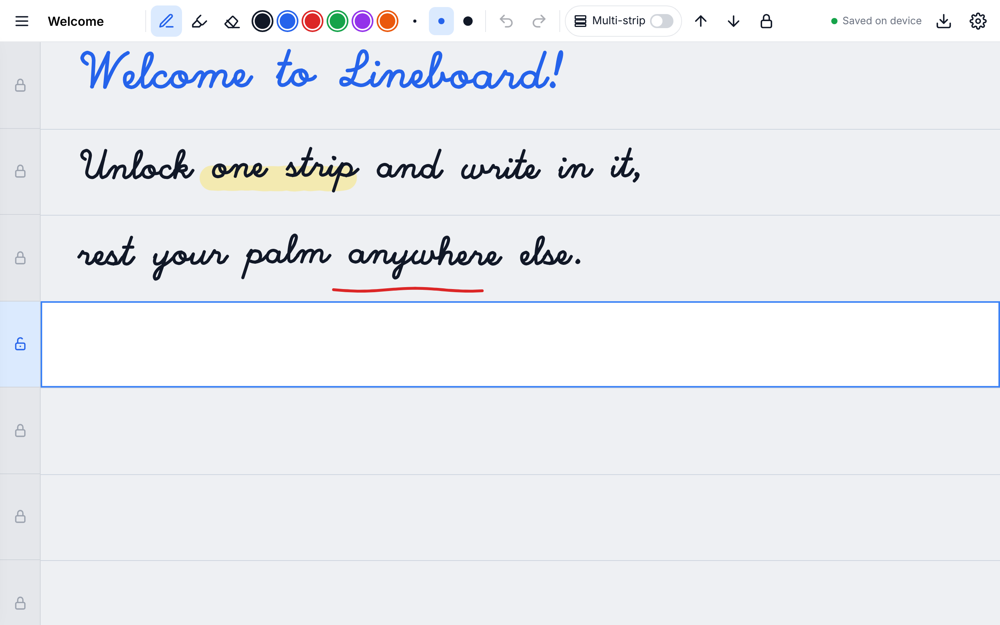

# Lineboard

**A handwriting whiteboard that ignores your palm, made for tablets without an active pen.**

Tablets like the Galaxy Tab A9 have no pen digitizer, so a capacitive stylus and a resting palm look the same to the screen,
and most note apps draw both. Lineboard avoids the guesswork: the page is split into horizontal **strips**,
and only the strip you unlock accepts ink. Rest your palm anywhere else.



[](LICENSE)

## Features

- **Strip lock.** Tap a lock in the margin to unlock a strip. Unlocking one locks the others.
- **Multi-strip mode** for drawings that span several lines. Turning it off locks everything again.
- **Palm-safe scrolling.** Drag the margin to scroll. Up / Down buttons (or arrow keys) move to the next line and keep it in the top part of the screen, leaving room for your hand.
- **Palm filtering inside the unlocked strip:**
  - only one stroke at a time (other contacts are ignored mid-stroke)
  - contacts larger than a size limit are ignored, with a calibration pad in Settings to tune it for your stylus
  - a stroke is cancelled if its contact grows into a palm partway through
  - if an active pen is detected, finger touches can be ignored entirely
- Pen (pressure-aware with active pens), highlighter, stroke eraser, undo / redo, multiple notes, PNG export.
- Accounts and sync with **Supabase**. Strokes save in the background through a queue that survives reloads and retries while offline.
- Installable as an app (PWA). Works in portrait and landscape: notes scale to the screen width.
- **Local mode**: with no backend configured, notes are stored in the browser. Handy for trying it out and for development.

## How it is built

| Part | Technology |
| --- | --- |
| Frontend | TypeScript + Vite, no UI framework, HTML canvas |
| Auth and database | Supabase (Postgres with row-level security) |
| Hosting | Docker image (nginx) on Azure App Service |
| CI/CD | GitHub Actions: tests, image published to GitHub Container Registry, deploy to App Service |

The browser talks directly to Supabase with the public anon key. Each user can only access their own rows,
enforced by row-level security in [`supabase/schema.sql`](supabase/schema.sql).
The container serves static files only and needs no secrets.

## Quick start (local)

Requires Node.js 20.19+.

```bash
npm install
npm run dev
```

Open http://localhost:5173. Without a `.env.local` it runs in local mode.
To try it on your tablet, run `npm run dev -- --host` and open the printed network address.

## Setup

### 1. Supabase

1. Create a project at [supabase.com](https://supabase.com).
2. In **SQL Editor**, run [`supabase/schema.sql`](supabase/schema.sql). It creates the tables and row-level-security policies and is safe to re-run.
3. In **Authentication -> URL Configuration**, set **Site URL** to your app's address (for example `https://<app-name>.azurewebsites.net`) and add it to **Redirect URLs**. Add `http://localhost:5173` too for development. These are needed for email confirmation, sign-in links and password reset.
4. In **Project Settings -> API**, copy the **Project URL** and the **anon / publishable** key.
   Never use the `service_role` / secret key with this app.
5. For real users, set up your own SMTP server under **Authentication -> Emails**. The built-in email sender is heavily rate-limited.

For local development against Supabase, copy `.env.example` to `.env.local` and fill in both values.

### 2. Azure App Service

The container reads two environment variables when it starts:

| Variable | Value |
| --- | --- |
| `SUPABASE_URL` | Supabase Project URL |
| `SUPABASE_ANON_KEY` | Supabase anon / publishable key |

The same image works for every environment. If both are empty, the app runs in local mode.
The container listens on port 80 and exposes a health check at `/healthz`.

#### Option A: automatic deploys with GitHub Actions (recommended)

1. **Publish the image.** Push the repository to GitHub. The [`release`](.github/workflows/release.yml) workflow builds the image on every push to `main` and publishes it to `ghcr.io/<owner>/<repo>`.
   Then open the package on GitHub (**your profile -> Packages -> lineboard -> Package settings**) and set its visibility to **Public**, so Azure can pull it without credentials.
2. **Create the web app:**
   ```bash
   az group create -n lineboard-rg -l <region>
   az appservice plan create -g lineboard-rg -n lineboard-plan --is-linux --sku B1
   az webapp create -g lineboard-rg -p lineboard-plan -n <app-name> \
     --container-image-name ghcr.io/<owner>/<repo>:latest
   az webapp config appsettings set -g lineboard-rg -n <app-name> --settings \
     SUPABASE_URL=https://<project>.supabase.co SUPABASE_ANON_KEY=<anon-key> WEBSITES_PORT=80
   ```
   In the portal, also set **Monitoring -> Health check** to `/healthz`.
3. **Let GitHub deploy to Azure (OpenID Connect, no passwords).**
   1. Azure portal -> **Microsoft Entra ID -> App registrations -> New registration**. Name it e.g. `lineboard-github-deploy`, keep the defaults, **Register**.
      Note its **Application (client) ID** and **Directory (tenant) ID**.
   2. In that app registration: **Certificates & secrets -> Federated credentials -> Add credential**.
      Scenario **GitHub Actions deploying Azure resources**, Organization `<owner>`, Repository `<repo>`,
      Entity type **Environment**, Environment name `production`. **Add**.
   3. Open your web app -> **Access control (IAM) -> Add -> Add role assignment** -> role **Website Contributor** ->
      Members: **User, group, or service principal** -> select `lineboard-github-deploy` -> **Review + assign**.
      This lets GitHub deploy to this one web app and nothing else.
   4. GitHub repository -> **Settings -> Secrets and variables -> Actions -> Variables** -> add:

      | Variable | Value |
      | --- | --- |
      | `AZURE_WEBAPP_NAME` | your web app name |
      | `AZURE_CLIENT_ID` | Application (client) ID |
      | `AZURE_TENANT_ID` | Directory (tenant) ID |
      | `AZURE_SUBSCRIPTION_ID` | subscription ID (shown on the web app's Overview) |

      These are identifiers, not secrets. Basic authentication on the web app can stay **off**.
   5. Recommended: **Settings -> Environments -> production -> Required reviewers** -> add yourself, so every deploy waits for your approval.

From then on, every push to `main` publishes a new image and deploys that exact version (`sha-<commit>`), after your approval if you added it. Forks without these settings only publish the image.

#### Option B: manual deploy with Azure Container Registry

```bash
az acr create -g lineboard-rg -n <registry> --sku Basic
az acr build -r <registry> -t lineboard:latest .
az webapp create -g lineboard-rg -p lineboard-plan -n <app-name> \
  --container-image-name <registry>.azurecr.io/lineboard:latest
az webapp config appsettings set -g lineboard-rg -n <app-name> --settings \
  SUPABASE_URL=https://<project>.supabase.co SUPABASE_ANON_KEY=<anon-key> WEBSITES_PORT=80
```

Give the web app permission to pull from the registry. The simplest way is to enable a managed identity on the web app and grant it the `AcrPull` role on the registry.

#### Run the container anywhere

```bash
docker build -t lineboard .
docker run -p 8080:80 -e SUPABASE_URL=https://<project>.supabase.co -e SUPABASE_ANON_KEY=<anon-key> lineboard
```

## Using it on a tablet

1. Open the site in Chrome, then choose **three-dot menu -> Add to home screen** (or **Install app**). It then opens full screen like a normal app.
2. Open **Settings**, write in the calibration box with your stylus, and press **Set limit from samples**.
   The "Last contact on page" line shows the size of each touch and whether it was drawn or ignored.
3. Some browsers always report a contact size of 1 px. Size filtering cannot help there, but the strip lock still works.

## Development

```bash
npm run dev         # dev server
npm run typecheck   # TypeScript checks
npm test            # end-to-end tests (run `npx playwright install chromium` once first)
npm run build       # production build in dist/
```

The tests in [`tests/`](tests/) send simulated stylus and palm contacts of different sizes and check what gets drawn.

### Project layout

```
src/
  board.ts              canvas engine: strips, margin locks, palm filtering, eraser, rendering, export
  app.ts                toolbar, notes sidebar, settings, undo / redo
  sync.ts               background save queue (persistent, retries while offline)
  store/                Supabase and local-only storage backends
  auth.ts               sign in, sign up, email link, password reset
supabase/schema.sql     tables and row-level security
tests/                  Playwright end-to-end tests
docker/                 container start-up script and security headers
Dockerfile, nginx.conf  production container
.github/workflows/      CI, image publishing and Azure deploy
```

Strokes are stored in page units (the page is always 1000 units wide), so notes look the same at any screen size and orientation.

## Costs and limits

- **Supabase Free** pauses a project after about a week with no activity, and includes 500 MB of database storage. A page of handwriting typically takes tens to a few hundred KB. Use a paid plan for anything people depend on.
- **Azure App Service**: a Linux Basic B1 plan is plenty for this app, since the container only serves static files.

## Contributing

Contributions and device reports are welcome. See [CONTRIBUTING.md](CONTRIBUTING.md).
Please report security issues privately as described in [SECURITY.md](SECURITY.md).

## License

[MIT](LICENSE)
