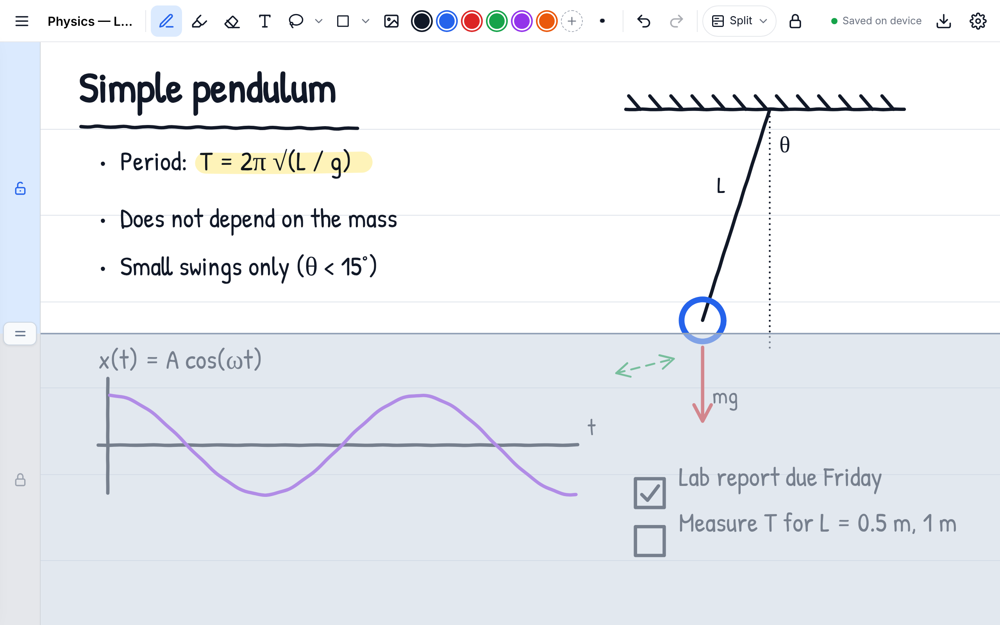

# Lineboard

**A handwriting whiteboard you can rest your hand on, made for tablets without an active pen.**

On a tablet without a pen digitizer, a capacitive stylus, a fingertip and a resting palm all look the same
to the screen, and some tablets react badly the moment a palm lands on it. Lineboard does not try to tell
them apart. It draws **one line** across the screen: above it, the page takes your ink; below it, the screen
is locked, so your hand and stray fingers can rest there without leaving marks. Drag the line to wherever
your hand sits, scroll the page underneath, and keep writing. That line is where the name comes from.



[](LICENSE)

## Features

- **The line (split mode, the default).** One line divides the screen into two panes:
  - write in the open pane; the locked one ignores every touch;
  - each pane has a lock in the margin, so you can switch which half you write in;
  - tap the grip on the line, then drag it, to move it;
  - the page scrolls underneath both panes.
- **Strips, for finer control.** Lock the page strip by strip: unlock one strip to write in it, or switch to
  **multi-strip** to unlock several at once for larger drawings.
- **Palm-safe scrolling.** Drag the margin to scroll, or step line by line with the arrow buttons or keys.
- **Palm filtering inside the open area, with nothing to set up.** Each time Lineboard opens it learns how big
  your writing contact is (a finger, a rubber-tipped stylus or a fine pen) from your first few strokes, then
  treats touches much bigger than that as a resting palm. It adjusts again when someone writes with a bigger
  contact, and never learns from a palm resting still. Also: one stroke at a time, strokes cancelled if a
  contact grows into a palm, optional pen-only input, and a manual limit with a calibration pad for those who
  want it. Taps on a locked part of the page explain how to write there.
- **Free whiteboard** when an idea needs the whole page: write anywhere, two fingers scroll and zoom, with
  plain, lined, grid or dotted paper.
- **Tools:**
  - pen, pressure-aware with active pens;
  - highlighter, stroke eraser, size slider, stroke smoothing, colours (including a custom one);
  - undo / redo, OS-aware keyboard shortcuts.
- **Shapes:** a palette of 19 shapes that snap to perfect squares, circles and 45° lines without a keyboard,
  with a Keep proportions switch, solid / dashed / dotted lines and four thicknesses.
- **Text boxes** with font (sans, serif, mono, handwriting), size, bold / italic / underline, alignment and
  colour; drag them to move.
- **Pictures:** insert, paste or drop them, draw on top, and move or resize them. With encryption on they are
  encrypted too.
- **Select:** lasso or rectangle (anything touched is picked), then move, resize, duplicate or delete.
- **Organise and export:** notebooks and notes, PNG export, manual orientation lock.
- **Stars and the archive.** Star notes (pinned under "Starred", whatever notebook they are in) and notebooks
  (listed first). Archive notes or notebooks to hide them; Settings → Data controls lists them to restore or
  delete. Each row's actions are in its ⋯ menu.
- **Trash.** The trash is a notebook of its own, opened from the bottom of the sidebar (or Settings → Data
  controls). Deleting a note asks, then moves it there; taking it out asks which notebook to put it in. A
  deleted notebook goes to the trash whole, its notes listed under it, and can only be restored whole.
  After 30 days it is deleted for good, or sooner with Delete forever or Empty trash.
- **Changes from other devices.** Coming back to the tab picks up notes and notebooks changed elsewhere. An
  action on something another device has deleted meanwhile (renaming it, moving a note into it) fails with
  a clear message instead of silently doing nothing, and the app catches up.
- **Clear page.** The toolbar button next to Undo and Redo erases everything on the page after asking. It is
  one undo step, and the page as it was stays in version history.
- **Search** (Ctrl/⌘ K, or Search in the sidebar): note titles and notebook names, each result labelled. Forgiving
  like most apps' search: case and accents ignored, words in any order, word starts and small typos match, the
  closest matches first; "quotes" for an exact phrase. Archived ones only when asked for.
- **Dark mode.** Light, dark, or the same as the device (Settings → Page & writing). In dark mode the page is dark
  too, and ink is shown with its lightness turned around (black shows near-white, colours keep their hue);
  notes, files, pictures and PDFs keep the colours they were drawn in.
- **Profile.** A display name and an optional picture, shown in the sidebar as initials or the picture (the
  email stays in Settings, out of screen recordings). The account menu there holds Profile, Data controls,
  Settings and Sign out.
- **Share as a file.** Send the open note as a PDF, a picture or a Lineboard file through the device's share
  menu (or as a download where there is none). Nothing is uploaded for sharing: Lineboard hosts no public pages.
- **Version history.** Versions are saved as you write (after a pause, and when you leave a note). Browse them
  read-only on the board, with new ink highlighted and removed ink faded. Restoring adds a new version on top,
  so nothing is ever lost and the restore can be undone. Make a copy of any version as a new note, fresh or with
  its history; name versions to keep them. Unnamed ones thin out over time (all from the last day, hourly for a
  week, daily for 90 days).
- **Lineboard files (`.lbd`).** Export a note, a notebook or all notes, and import them back by file, by a zip of
  several, or by dropping one on the board. Pictures travel inside the file. See [the format](docs/file-format.md).
- **Your data:** download everything (your account details, plus all notes and their history as an `.lbd`), or delete your account
  (Settings → Data controls).
- **Accounts and sync** with Supabase, with background saving that survives reloads and offline periods.
- **Account security.** See and sign out signed-in devices, change the password (which signs out other
  devices, as does a password reset), two-step verification with an authenticator app, and passkey sign-in.
  See [Account security](#account-security).
- **Optional end-to-end encryption.** Turn it on in Settings → Encryption: ink, note titles and
  notebook names are encrypted on the device before upload. See [End-to-end encryption](#end-to-end-encryption).
- **Try without an account.** Notes stay in the browser and move into the account on sign-in.
- **Local mode.** With no backend configured, the whole app runs in the browser with no sign-in.
- Installable as a PWA; works in portrait and landscape.

## How it works

Lineboard is a static TypeScript app (Vite, no UI framework, HTML canvas). In production it is served by
nginx in a Docker image.

The browser talks directly to Supabase using the public anon / publishable key. Access control lives in the
database: row-level security in [`supabase/schema.sql`](supabase/schema.sql) limits every user to their own
rows. The container holds no secrets.

Strokes are stored as point lists in page units (the page is 1000 units wide), so notes render the same at
any screen size or orientation.

### Account security

Settings → Sign-in & devices, built on Supabase Auth:

- **Signed-in devices.** Supabase has no client API for listing sessions, so `list_my_sessions()` and
  `revoke_my_session()` in [`supabase/schema.sql`](supabase/schema.sql) expose the user's own rows of
  `auth.sessions` (device from the user agent, IP, last activity). "Sign out all other devices" uses
  `signOut({ scope: 'others' })`.
- **Immediate sign-out.** A restrictive row-level-security policy (`access_ok()`) requires the request's
  session to still exist, so a signed-out device loses access to notes at once instead of when its access
  token expires (up to an hour). The app also re-checks its session when the tab regains focus and every
  five minutes, and returns to the sign-in page.
- **Passwords.** Changing the password needs the current one: the app checks it, and sends it as
  `current_password` so the server checks it too when *Require current password* is on in the project's
  Auth settings. Accounts without a password (email-link or passkey sign-up) confirm with an emailed code
  instead. It signs out other devices by default; so does a password reset from the email link.
- **Confirm it's you.** These ask for the password if it wasn't entered in the last five minutes:
  - adding or removing a passkey or authenticator;
  - turning encryption on or off;
  - downloading your data and deleting the account.

  So someone at an unlocked device can't add their own way in, take the data, or lock the owner out. With
  two-step verification on, they need the password **and** a fresh authenticator code, so a stolen password
  alone gets past nothing. Changing the password needs the code too.
- **Two-step verification** with any TOTP authenticator app (`auth.mfa`). Several authenticators can be
  added as backups. The same `access_ok()` policy requires `aal2` for users who turned it on, so notes can't
  be read with the password alone even by calling the API directly. Turning it on signs out other devices.
- **Passkeys** (`signInWithPasskey` / `registerPasskey`, supabase-js 2.105+). Enable them in the Supabase
  dashboard under Authentication → Passkeys with your site's domain as the relying party ID; until then the
  passkey card explains they're unavailable and the sign-in button reports the server's error.

In the Supabase dashboard, turn on TOTP under Authentication → Multi-Factor (it is on by default for new
projects) and passkeys under Authentication → Passkeys.

### End-to-end encryption

Encryption is off by default and each user turns it on for their own account in Settings. It uses the
envelope scheme common to password managers, built only on the browser's Web Crypto API
([`src/crypto/`](src/crypto)):

- A random AES-256-GCM **data key** encrypts each stroke, note title and notebook name. The row id is bound
  in as associated data, so ciphertext can't be moved between rows.
- The data key is stored on the server only **wrapped** twice: once by a key derived from the user's
  **encryption passphrase** (PBKDF2-SHA256, 600,000 rounds, random salt) and once by a 160-bit **recovery
  key** shown to the user once. The passphrase is separate from the login password, so a password reset by
  email cannot unlock notes.
- Each device unlocks once; the data key can be kept in IndexedDB as a non-extractable `CryptoKey`
  ("Keep this device unlocked"). Signing out forgets it.
- Turning encryption on (or off) converts existing notes in place. The work is resumable: if the tab is
  closed midway, it finishes the next time the user opens Lineboard.
- Once it is on, row-level security refuses plaintext notes for that user, so an outdated client or another
  device can't silently save unencrypted ink; the app then asks for the passphrase and retries.
- Forgetting the passphrase: unlock with the recovery key and choose a new one. Losing both: the notes cannot
  be recovered by anyone; the user can delete them and start over.

The server still sees metadata: ids, timestamps, which note each stroke belongs to, and ciphertext sizes.
Settings (strip height, pen colours) are not encrypted. Unsaved strokes waiting in the offline queue are kept
in the browser's local storage on the device.

## Quick start

Requires Node.js 20.19+.

```bash
npm install
npm run dev        # http://localhost:5173, local mode
```

Or run the published image:

```bash
docker run -p 8080:80 ghcr.io/lnandanapalli/lineboard
```

Without configuration, both run in local mode: notes are kept in the browser and there is no sign-in.

## Public pages

New visitors see the homepage at `/` or `/home`. `/login` and `/signup` open separate
account screens when Supabase is configured; `/app` opens the notebook. Returning
local/guest users resume their notes. `/terms` and `/privacy` remain directly accessible.
Navigation uses browser history without reloading the app. The container's nginx
`try_files` fallback serves the app shell for direct visits and refreshes of these paths;
other static hosts need the equivalent SPA fallback. Existing `/#home`, `/#app`, and
other old hash-route bookmarks redirect to the corresponding clean path.

Authentication emails return to the site root (`https://your-site/`), preserving the
existing Supabase redirect allowlist requirement. Auth callback tokens are handled by
Supabase, separately from page routing.

Terms and privacy pages describe the app's current behavior. Before a public launch, the site
operator should review them and confirm hosting-specific retention/privacy information in
`src/public.ts`. They currently identify `@lnandanapalli` and link to GitHub Issues for support;
self-hosters should update those details for their own installation.

## Configuration

To enable accounts and sync, point Lineboard at a Supabase project:

| Docker (read at container start) | Vite dev / build | Value |
| --- | --- | --- |
| `SUPABASE_URL` | `VITE_SUPABASE_URL` | Project URL, e.g. `https://<ref>.supabase.co` (no path) |
| `SUPABASE_ANON_KEY` | `VITE_SUPABASE_ANON_KEY` | Anon or publishable key |
| `CANONICAL_HOST` (optional) | (not used) | The one address to serve, e.g. `example.com`. The other spelling (`www.example.com`, or the reverse) gets a permanent redirect to it. |
| `TURNSTILE_SITE_KEY` (optional) | `VITE_TURNSTILE_SITE_KEY` | Cloudflare Turnstile site key: turns on the bot check at sign-in, sign-up and password reset. Pair it with the secret key in Supabase (see [Security](#security-and-abuse-protection)). |

Serve the app from one address. Browsers keep sign-ins, notes made without an account, the remembered
encryption key and passkey origins separately for `example.com` and `www.example.com`, so set
`CANONICAL_HOST` if both reach the site. The site's platform hostname (e.g. `*.azurewebsites.net`) is not
redirected, and neither is `/healthz` on any hostname.

For development, copy `.env.example` to `.env.local`. Never use the `service_role` / secret key.

### Database

Run [`supabase/schema.sql`](supabase/schema.sql) once in your project (SQL editor or `psql`). It creates the
`notebooks`, `notes`, `strokes`, `user_settings` and `user_keys` tables with row-level security, and is safe to
re-run. **When upgrading, run it again**: until you do, the app keeps working, but features that need newer
tables or columns (the encryption switch, text boxes, pictures, account deletion) say they need the database update
(and deleting stays permanent, without the trash, until it has run),
and the fair-use limits only apply once it has run.

In Supabase Auth, add your site's URL to the allowed redirect URLs so that confirmation, sign-in-link and
password-reset emails work.

### Security and abuse protection

Built in:

- **Data isolation:** row-level security: every account reaches only its own rows and picture files, and a device that was signed out elsewhere loses access at once (`access_ok()` in the schema).
- **Optional user protections:** end-to-end encryption, two-step verification, passkeys, a list of signed-in devices, and a fresh password check before sensitive changes ("Confirm it's you"), plus an authenticator code when two-step verification is on.
- **Fair-use limits, enforced by the database:**
  - 500 notebooks and 20,000 notes per account;
  - 50,000 strokes per note and 2,000,000 strokes in all;
  - version history: 500 versions per note and 1 GB per account;
  - pictures: image types only, at most 15 MB each, and 5,000 files or 2 GB per account.
  - The app explains a refused save instead of retrying it.
  - Every input and stored value has a range; see [Limits](#limits).
- **Web server:**
  - per-client request rate limiting, with HTTP 429 for floods;
  - GET and HEAD only, with a tiny request-body limit;
  - security headers: CSP, HSTS, COOP, `X-Frame-Options`, `nosniff` and a referrer policy.
- **Your data:** Settings > Account > Download my data / Delete account. A one-time notice explains the browser storage, which is essential-only, so no consent banner is needed.

To do in the Supabase dashboard (Authentication settings):

1. **Bot check (recommended).** Create a free Cloudflare Turnstile widget for your domain.
   - Put its **secret key** under Attack Protection > CAPTCHA protection (provider: Turnstile).
   - Set its **site key** as `TURNSTILE_SITE_KEY`.
   - Set both at the same time: with only the secret set, every sign-in is refused; with only the site key set, the check is shown but not enforced.
2. **Rate limits:** keep the defaults, or lower them, for sign-ups, sign-ins, OTP / email links and token refreshes.
3. **Email:** keep *Confirm email*, *Secure email change* and *Secure password change* on, and use your own SMTP provider for production email.
4. **Passwords:** set the minimum length to 8 or more. Turn on leaked-password protection if your plan has it.
5. **Redirect URLs:** allow only your site's URL.

Report vulnerabilities privately as described in [SECURITY.md](SECURITY.md).

### Deployment

The image is a plain static site on port 80 with a health check at `/healthz`, so it runs on any container
host. The included GitHub Actions publish it to GitHub Container Registry and can optionally deploy to
Azure App Service; see [docs/deployment.md](docs/deployment.md).

## Development

```bash
npm run dev         # dev server
npm run typecheck
npm test            # Playwright end-to-end tests (run `npx playwright install chromium` once)
npm run build       # production build in dist/
npm run screenshot  # regenerate docs/screenshot.png
```

The tests simulate stylus and palm contacts of different sizes, and cover the signed-in flows against an
in-memory Supabase stand-in, so they need no backend or keys.

```
src/board.ts        canvas engine: split / strips, palm filtering, eraser, rendering, export
src/app.ts          toolbar, notes, settings, undo / redo
src/sync.ts         background save queue
src/store/          Supabase and browser storage backends
src/guest.ts        moving notes from "try without an account" into an account
src/auth.ts         sign-in screens
supabase/           database schema
tests/              Playwright tests
docker/, nginx.conf container start-up and security headers
```

## Contributing

Contributions and device reports are welcome; see [CONTRIBUTING.md](CONTRIBUTING.md).
Please report security issues privately as described in [SECURITY.md](SECURITY.md).

## License

[MIT](LICENSE)

## Limits

Every value a user can enter, add or import has a minimum and a maximum. The app enforces them so people get a
clear message early (in `src/limits.ts` and next to each feature), and the database or file reader enforces them
again in case anything gets past the app.

| What | Minimum | Maximum | Enforced in |
| --- | --- | --- | --- |
| Note title | empty (shown as "Untitled") | 200 characters | app, database |
| Notebook name | empty ("Untitled notebook") | 120 characters | app, database |
| Version name | none (unnamed) | 120 characters | app, database |
| Display name | empty (no name) | 60 characters, without control or invisible characters | app |
| Text box | 1 character (an empty box is removed) | 10,000 characters | app, database, files |
| Search query | none | 200 characters, 12 words; 50 results shown | app |
| Email | a valid address | 254 characters | app, Supabase Auth |
| Password | 8 characters | 72 characters (bcrypt) | app, Supabase Auth |
| Encryption passphrase | 10 characters | 256 characters | app |
| Stroke | 1 point | 20,000 points (longer ones continue as a new stroke) | app, database, files |
| Pen / highlighter / text size | 1 / 6 / 10 | 24 / 60 / 100 page units | app, database (100) |
| Strokes | — | 50,000 per note, 2,000,000 per account | database, files |
| Notes / notebooks | 1 notebook is always kept | 20,000 notes, 500 notebooks | app, database |
| Versions | the newest is always kept | 500 per note, 1 GB per account, 11 MB packed each | app, database |
| Pictures | — | 15 MB each, 20 added at once, 5,000 files or 2 GB per account; 2000 px longest side | app, storage |
| Profile picture | — | 15 MB file, stored as 256 × 256 | app, storage |
| Import file | — | 1.5 GB; 1,000 files in a zip; 20,000 notes, 5,000,000 strokes and 1.5 GB unpacked per import | app |
| Settings | each within its control's range | 20,000 bytes stored | app, database |
| Sidebar width | 240 px | 560 px and 60% of the screen | app |
| Zoom (free mode) | 1× | 4× | app |
| Split divider | 15% | 85% of the board | app |
| Undo | — | 300 steps | app |

